# 🌿 SugarCane AI — Morogoro, Tanzania

> An AI-powered web platform for sugarcane farmers in Morogoro, Tanzania. Upload a leaf photo or enter farm data to get instant disease detection, yield forecasting, maturity timing, pest alerts, and variety identification — powered by trained machine learning models.

---

## 📋 Table of Contents

- [Overview](#overview)
- [Screenshots](#screenshots)
- [AI Models](#ai-models)
- [Tech Stack](#tech-stack)
- [Project Structure](#project-structure)
- [Getting Started](#getting-started)
- [API Documentation](#api-documentation)
- [Author](#author)

---

## Overview

SugarCane AI is a full-stack web application built for sugarcane farmers in Morogoro, Tanzania. It uses trained deep learning and machine learning models to help farmers detect diseases, forecast yield, time their harvest, identify pests, and classify variety — all from a simple web interface.

**Backend:** FastAPI · PostgreSQL · TensorFlow · XGBoost · LightGBM  
**Frontend:** React 18 · TypeScript · TailwindCSS · Leaflet · Recharts

---

## Screenshots

### 🏠 Landing Page — AI Modules Carousel

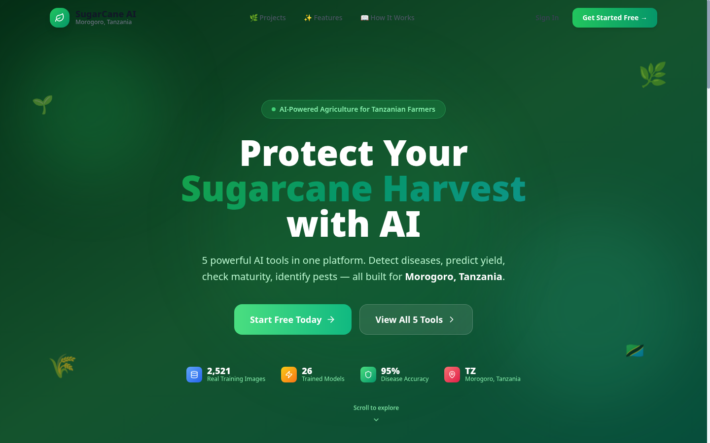

*The home page showcases all 5 AI tools in an interactive carousel. Each card shows the tool name, description, features, and model performance badge.*

---

### ✨ Explore All AI Tools

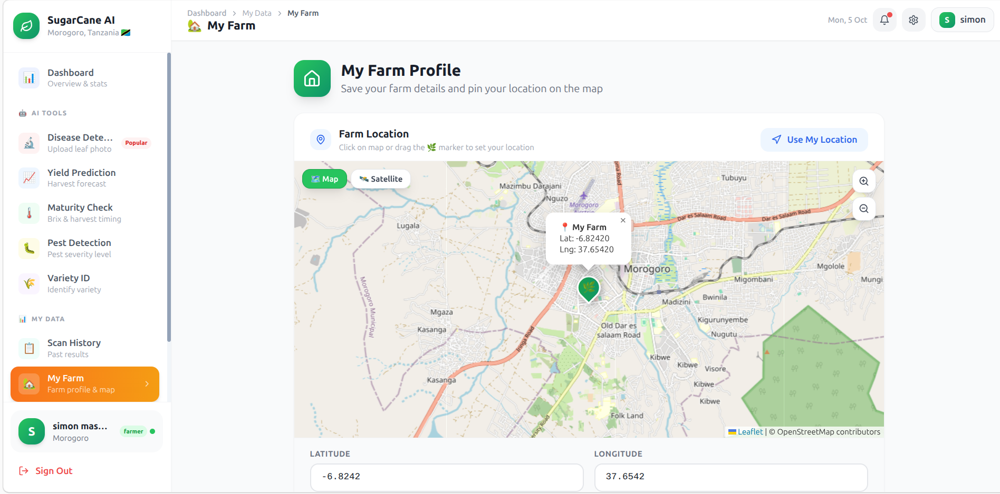

*The features section lists all 5 AI tools as cards — Disease Detection, Yield Prediction, Maturity Prediction, Pest Detection, and Variety Classification. Click any card to open that tool directly.*

---

### 🌿 Disease Detection Carousel Slide

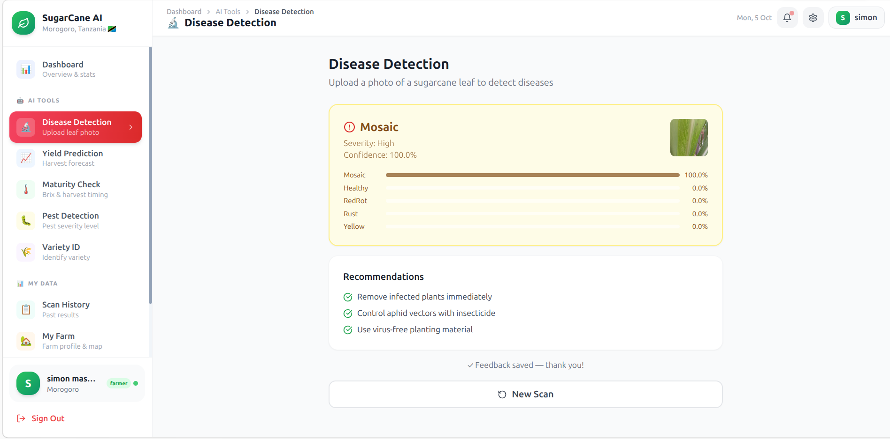

*Disease Detection slide — EfficientNetB0 model, 95% accuracy. Detects 5 classes: Healthy, Mosaic, RedRot, Rust, Yellow.*

---

### 🌡️ Maturity Prediction Carousel Slide

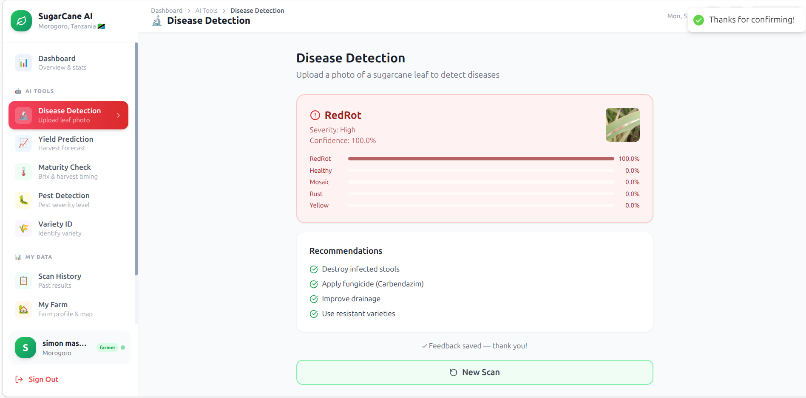

*Maturity Prediction slide — predicts Brix value (sugar content) so farmers know the exact optimal harvest day to maximize price at the sugar mill.*

---

### 🐛 Pest Detection Carousel Slide

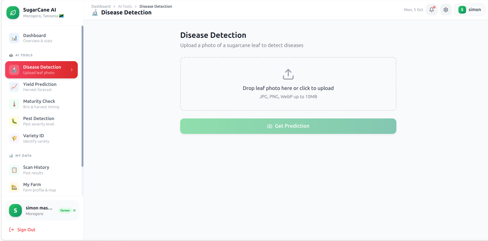

*Pest Detection slide — identifies infestation severity (Low / Medium / High) and gives specific pesticide recommendations before the crop is damaged.*

---

### 📖 How It Works

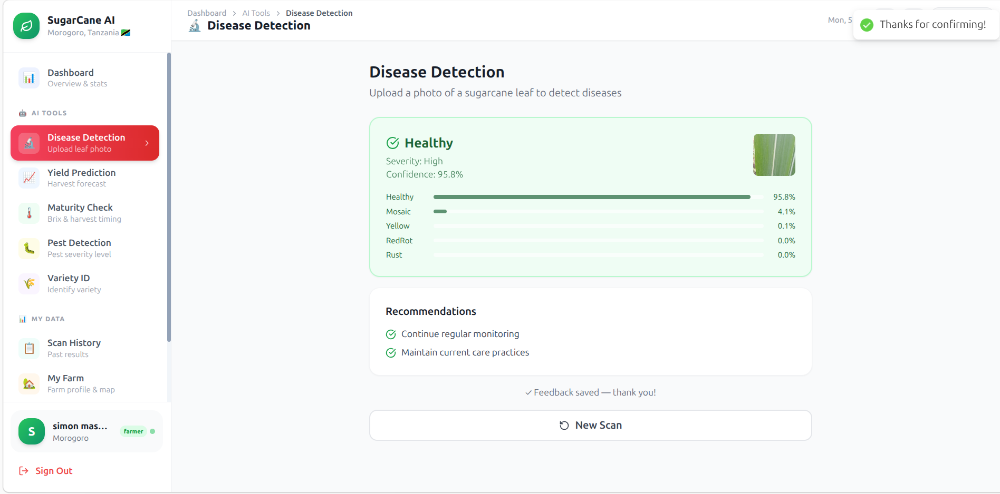

*Three simple steps: (1) Create Account → (2) Scan Your Crop → (3) Get Results. The CTA section invites farmers to start free with no credit card.*

---

### 🔐 Login

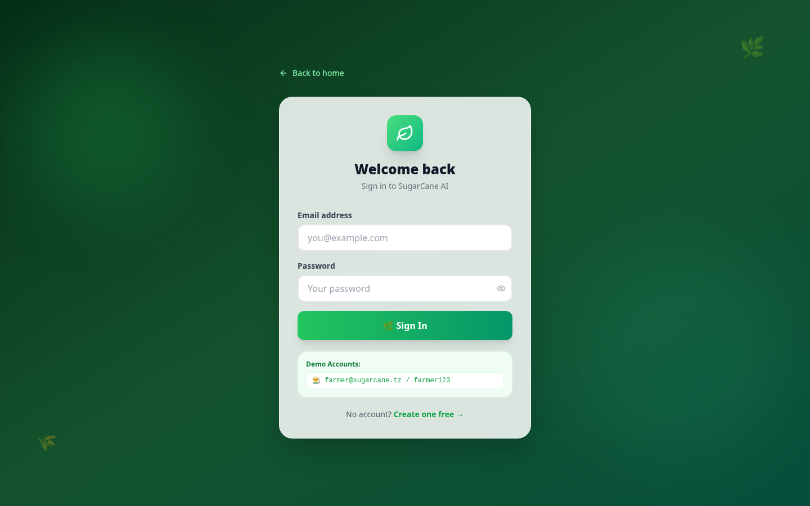

*Login page with email and password. Dark green theme consistent with the SugarCane AI brand. Includes "Back to home" link.*

---

### 📝 Register

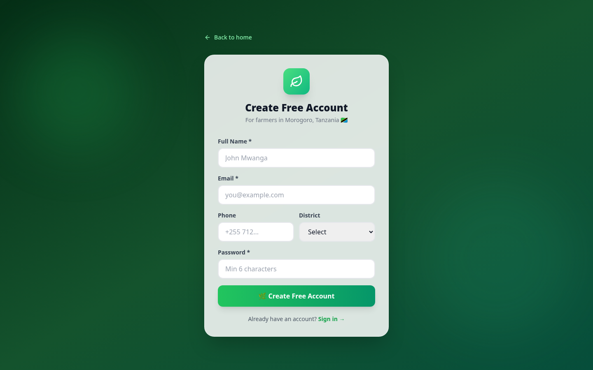

*Registration form for new farmers — collects full name, email, phone, password, and district (Morogoro region only). Free account, no credit card required.*

---

### 📊 Dashboard

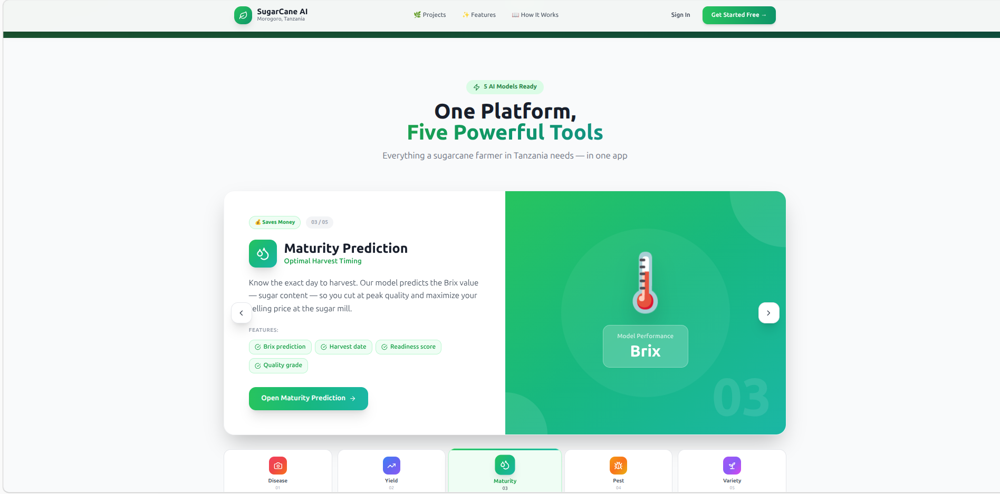

*The main dashboard after login. Shows real-time stats (total scans, diseases detected, yield checks, pest checks), quick-access cards for all 5 AI tools, and analysis charts.*

---

### 🔬 Disease Detection — Upload

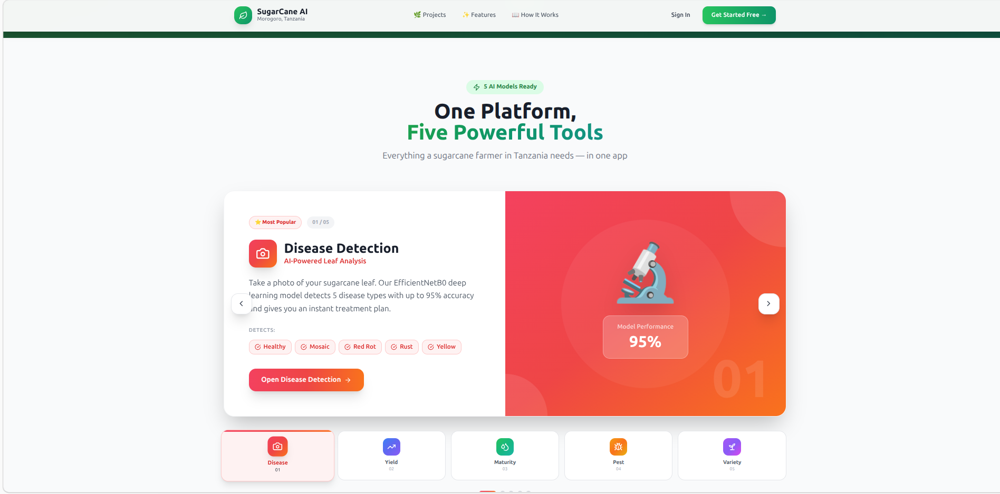

*Upload interface for disease detection. Farmer drags or clicks to upload a leaf photo (JPG/PNG/WebP up to 10MB), then clicks "Get Prediction".*

---

### 🔬 Disease Detection — Mosaic Result

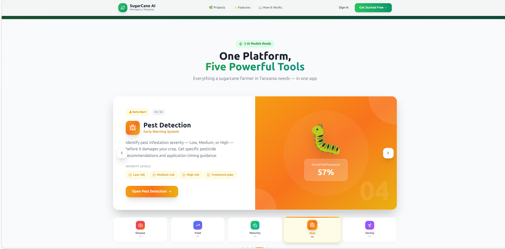

*Real prediction result: Mosaic detected at 100% confidence. Shows probability bars for all 5 classes and actionable recommendations (remove infected plants, control aphid vectors, use virus-free material).*

---

### 🔬 Disease Detection — RedRot Result

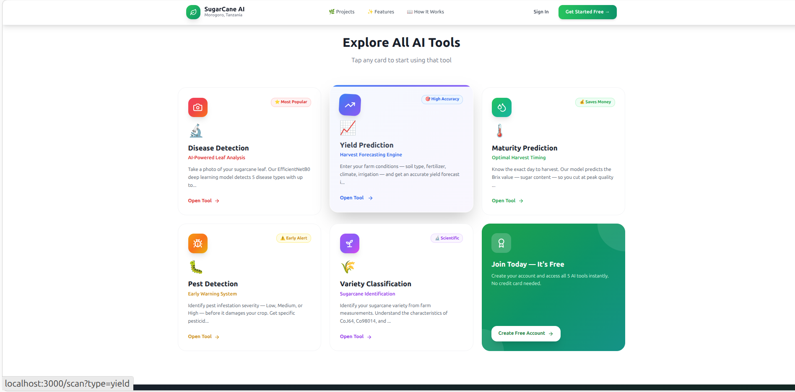

*RedRot detected at 100% confidence. Recommendations: destroy infected stools, apply Carbendazim fungicide, improve drainage, use resistant varieties.*

---

### 🔬 Disease Detection — Healthy Result

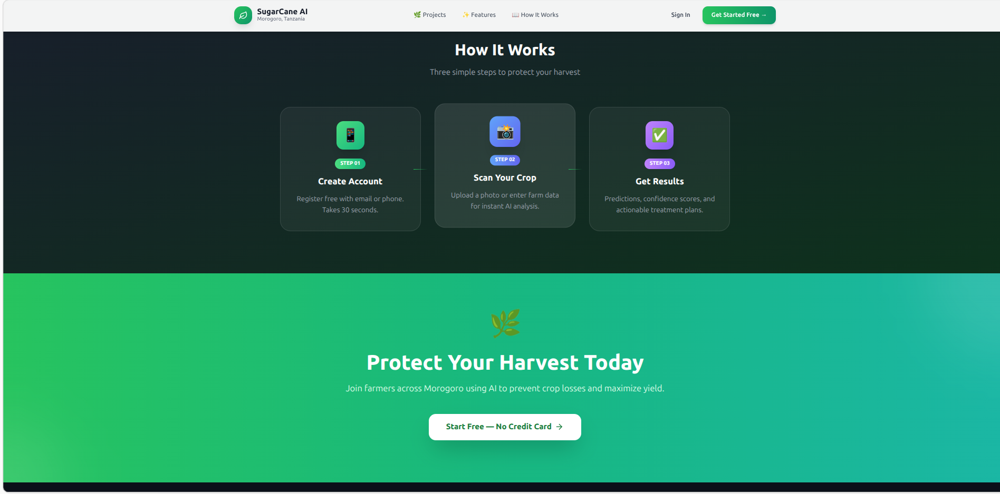

*Healthy leaf detected at 95.8% confidence. The model correctly identifies healthy cane and advises the farmer to continue regular monitoring and current care practices.*

---

### 📈 Yield Prediction

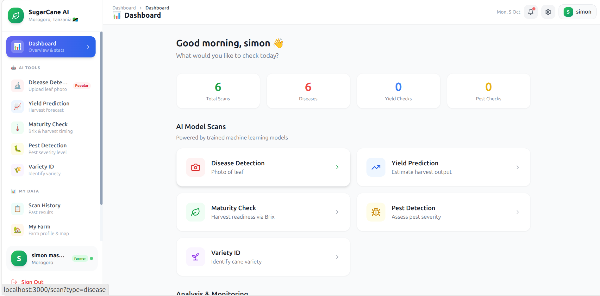

*Yield prediction form — farmer enters cane height, diameter, crop age, nitrogen level, rainfall, temperature, soil type, growth stage, season, and irrigation method to get a harvest forecast in quintal/acre.*

---

### 🗺️ My Farm — Location Map

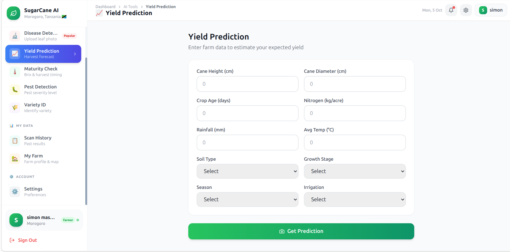

*Farm profile page with an interactive OpenStreetMap. Farmer pins their exact field location (Lat: -6.8242, Lng: 37.6542 — Morogoro area). GPS coordinates are stored for location-based analysis.*

---

### 🌐 API Documentation

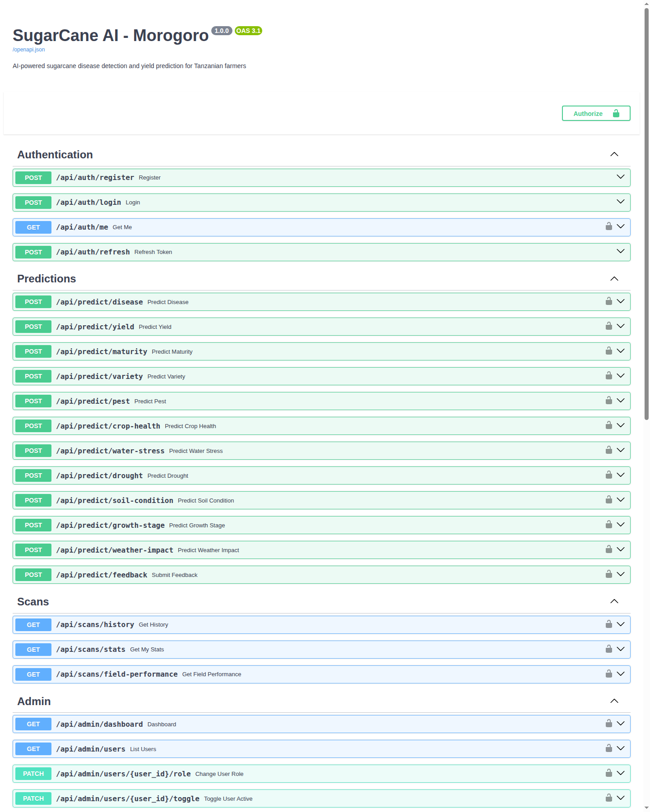

*Swagger UI at `http://localhost:8000/docs` — interactive documentation for all API endpoints including auth, predictions, scan history, and admin routes.*

---

## AI Models

| # | Module | Algorithm | Accuracy | Input |
|---|--------|-----------|----------|-------|
| 1 | Disease Detection | EfficientNetB0 (CNN) | **94.52%** | Leaf image (224×224) |
| 2 | Yield Prediction | LightGBM | **R²=0.90** | Farm measurements |
| 3 | Maturity Prediction | Random Forest | Brix value | Crop age, temp, Brix |
| 4 | Pest Detection | Gradient Boosting | 57% | Field observations |
| 5 | Variety Classification | XGBoost | 35% | Stem measurements |

### Disease Detection Training Results

```
=======================================================
RESULTS - Disease Detection
=======================================================
  EfficientNetB0  : 94.52%  loss=0.1648  ← BEST
  ResNet50        : 92.95%  loss=0.2898
  InceptionV3     : 87.99%  loss=0.3768
  MobileNetV2     : 76.76%  loss=0.6345
=======================================================
Training data : 2,521 images | 5 classes | GPU: T4
Classes       : Healthy, Mosaic, RedRot, Rust, Yellow
```

---

## Tech Stack

### Backend
| Technology | Purpose |
|-----------|---------|
| **FastAPI** | REST API framework |
| **PostgreSQL** | Primary database |
| **SQLAlchemy (async)** | ORM |
| **JWT** | Authentication |
| **TensorFlow / Keras** | Disease detection (EfficientNetB0) |
| **XGBoost** | Variety classification |
| **LightGBM** | Yield prediction |
| **Scikit-learn** | Maturity & pest models |

### Frontend
| Technology | Purpose |
|-----------|---------|
| **React 18 + TypeScript** | UI framework |
| **Vite** | Build tool |
| **TailwindCSS** | Styling |
| **Redux Toolkit** | State management |
| **React Router v6** | Navigation |
| **Leaflet** | Farm location map |
| **Recharts** | Analytics charts |

---

## Project Structure

```
sugarcane_web/
├── backend/
│   ├── app/
│   │   ├── api/routes/
│   │   │   ├── auth.py              # Register, login, refresh token
│   │   │   ├── predictions.py       # All 5 AI prediction endpoints
│   │   │   ├── scans.py             # Scan history
│   │   │   └── admin.py             # Admin dashboard
│   │   ├── core/
│   │   │   ├── config.py            # Settings & environment variables
│   │   │   └── security.py          # JWT auth
│   │   ├── db/session.py            # Database connection
│   │   ├── ml/model_loader.py       # Load all AI models at startup
│   │   ├── models/                  # Database models (User, Scan, Farm)
│   │   ├── services/
│   │   │   └── prediction_service.py  # AI inference logic
│   │   └── main.py                  # FastAPI app entry point
│   ├── requirements.txt
│   └── Dockerfile
├── frontend/
│   ├── src/
│   │   ├── pages/
│   │   │   ├── Home.tsx             # Landing page with carousel
│   │   │   ├── Dashboard.tsx        # Main dashboard
│   │   │   ├── Scan.tsx             # AI prediction tool
│   │   │   ├── History.tsx          # Past scan results
│   │   │   ├── Farm.tsx             # Farm map & profile
│   │   │   └── Admin.tsx            # Admin panel
│   │   ├── store/                   # Redux state management
│   │   └── App.tsx                  # Routes & auth guards
│   ├── package.json
│   └── Dockerfile
└── screenshots/                     # UI screenshots (this README)
```

---

## Getting Started

### Prerequisites
- Python 3.10+
- Node.js 18+
- PostgreSQL 14+

### Backend Setup

```bash
cd backend

# Create and activate virtual environment
python3 -m venv .venv
source .venv/bin/activate

# Install dependencies
pip install -r requirements.txt

# Create database
createdb sugarcane_db

# Configure environment
cp .env.example .env
# Edit .env: DATABASE_URL, SECRET_KEY, MODELS_DIR

# Place trained model
mkdir -p ~/sugarcane_models/04_disease
# Copy EfficientNetB0_best.keras → ~/sugarcane_models/04_disease/

# Start backend
uvicorn app.main:app --reload --port 8000
```

### Frontend Setup

```bash
cd frontend
npm install
npm run dev
```

| Service | URL |
|---------|-----|
| Frontend | http://localhost:3000 |
| Backend API | http://localhost:8000 |
| API Docs | http://localhost:8000/docs |

---

## API Documentation

Interactive Swagger UI at **http://localhost:8000/docs**

### Key Endpoints

```
POST  /api/auth/register        Register new farmer account
POST  /api/auth/login           Login → returns JWT token
GET   /api/auth/me              Get current user profile

POST  /api/predict/disease      Upload leaf image → disease result
POST  /api/predict/yield        Farm data → yield forecast (quintal/acre)
POST  /api/predict/maturity     Crop data → Brix value & harvest date
POST  /api/predict/pest         Field data → pest severity + treatment
POST  /api/predict/variety      Stem data → variety (CoJ64/Co98014/Co0238)

GET   /api/scans/history        All past scan results
GET   /api/scans/{scan_id}      Single scan detail

GET   /api/admin/stats          System statistics
GET   /api/admin/users          All registered users
```

### Quick Test

```bash
# Register
curl -X POST http://localhost:8000/api/auth/register \
  -H "Content-Type: application/json" \
  -d '{"email":"farmer@example.com","password":"Pass1234!","full_name":"John Mwanga","region":"Morogoro"}'

# Login → copy the access_token
curl -X POST http://localhost:8000/api/auth/login \
  -H "Content-Type: application/json" \
  -d '{"email":"farmer@example.com","password":"Pass1234!"}'

# Predict disease
curl -X POST http://localhost:8000/api/predict/disease \
  -H "Authorization: Bearer <your_token>" \
  -F "image=@leaf_photo.jpg"
```

---

## User Roles

| Role | Access |
|------|--------|
| **Farmer** | All 5 AI tools, farm profile, scan history, settings |
| **Admin** | Farmer access + user management, system stats, model monitoring |
| **Researcher** | Farmer access + research data export |

---

## Author

**Simon Masalago**  
BSc. Computer Science & Engineering — University of Dodoma (UDOM)  
Morogoro, Tanzania 🇹🇿

> *"Built to solve real problems for sugarcane farmers in Morogoro, Tanzania."*
